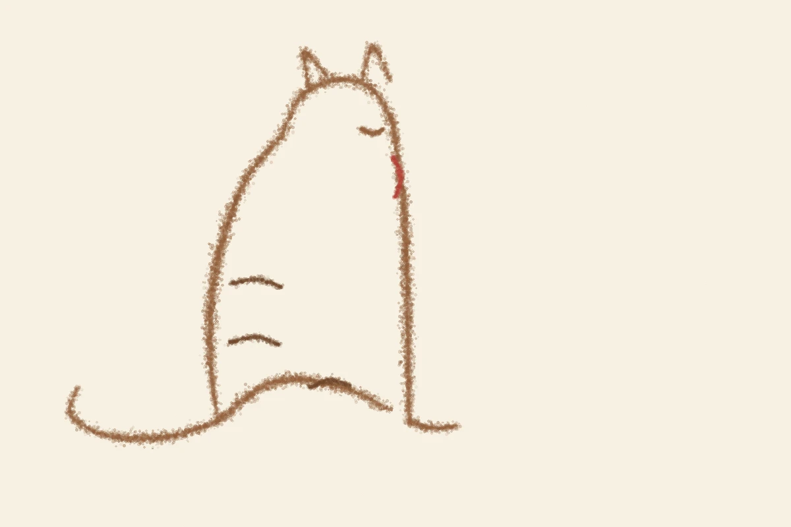
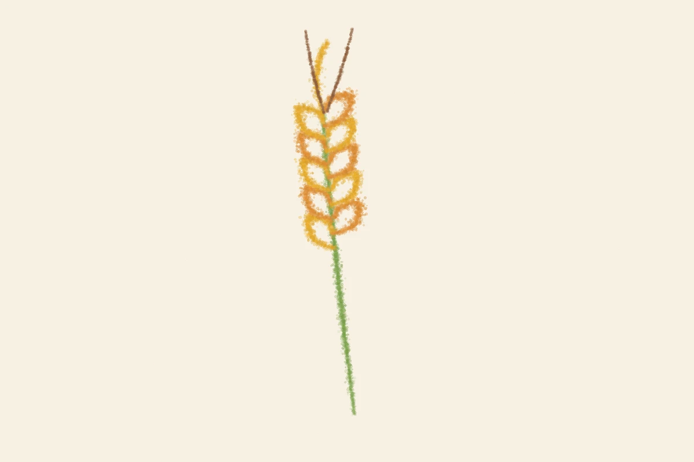
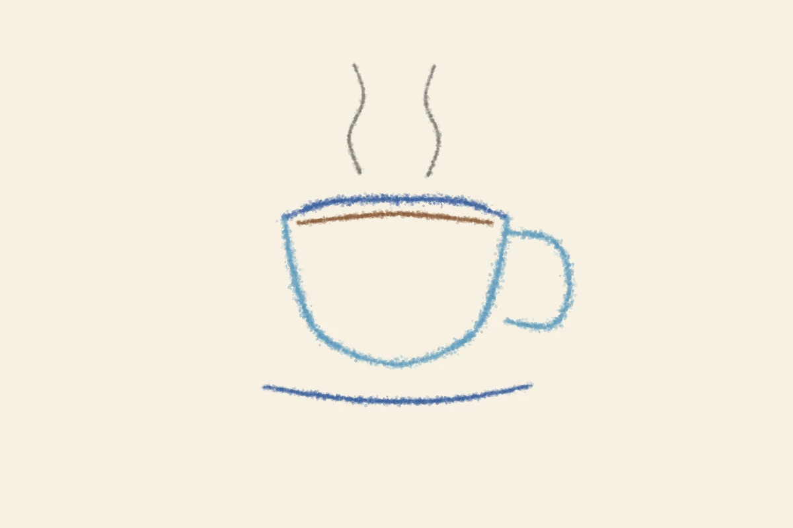

# mugiwe-drawing

むぎえ（mugiwe）のイラスト描画エンジン。「AI が画像を直接生成する」のではなく、**言語モデルが筆運びのデータ（座標・筆圧・速さ）を書き、エンジンがペンの物理をシミュレーションして線を描く**方式の実験リポジトリです。

設計の発想は [AI書道コンクール](https://aishodo.enpitsu.org/engine) の「言語モデル × sho.js」から得ましたが、書道の雰囲気を真似るものではありません。あちらは毛筆と書のエンジン、こちらはイラスト用の線画エンジンとして、独自に育てていきます。

## しくみ

1. **描き手（言語モデル）** が、その日のモチーフについて筆運びデータを書く（JSON）。
2. **エンジン（engine.py）** が画材と紙の物理だけを再現する:
   - 線の太さ・濃さは画材と筆圧で決まる（下の「画材」参照）
   - 墨は距離 × 速さで減っていき、速く乾いた筆は「かすれ」になる
   - ゆっくりした所・溜めた所では墨が溜まって線が丸く膨らむ
   - 鉛筆・色鉛筆は顔料の粒子で線ができ、重ねると粒子が混ざって混色になる
   - 紙の目と、手の震え（シード付きの決定的な揺らぎ）
3. 同じデータからは必ず同じ絵が生まれます。絵の差は、すべて描き手の書いた数値の差です。

つまりこれは、画像生成モデルの「いかにも AI」な均質さとは逆向きのアプローチで、むぎえ自身の「手の癖」を育てるための道具です。

## 画材（brush.tool）

線ごとに画材を選べます。現在の本命は **colorpencil（色鉛筆）** です。

| tool | 物理 | 性格 |
|---|---|---|
| colorpencil | 顔料粒子。筆圧は濃さに効く。粒子ごとに色がばらつき、重ねで混色 | 本命。イラストレーターの下描きのような温度 |
| pencil | 黒鉛粒子。色鉛筆のモノクロ版 | 静かなモチーフに |
| fountain | 万年筆。穏やかな膨らみ、安定したインクの流れ | インクの線がほしいときに |
| brushpen | 筆ペン。筆より硬く、太さの幅が狭い | |
| brush | 毛筆。筆圧で太さ、速さと墨量でかすれ（v2 までの本命） | 書道寄り。現在は脇役 |
| calligraphy | 平らなニブ。線幅が運ぶ方向で決まる | 個性が強い。アクセント向き |
| felt | フェルトペン。ほぼ均一な太さ、溜めで少し膨らむ | クリーンだが匿名性も高い |

## 色鉛筆パレット（palette.json）

「むぎえの色鉛筆箱 v1」= 固定 12 色。原則この中から選び、足りない色は重ね塗りの混色で作ります。

あか / だいだい / やまぶき / きみどり / みどり / みずいろ / あお / むらさき / ももいろ / ちゃ / こげちゃ / ねずみ

## 使い方

```bash
python3 engine.py motifs/cat-color.json out.webp
```

依存: Python 3 + Pillow。

## データ形式

```json
{
  "seed": 11,
  "strokes": [
    {
      "brush": {"size": 17, "ink": [146, 96, 60], "tone": 1.0, "load": 1.0, "tool": "colorpencil"},
      "points": [[330, 640, 0.15, 0.7, 0.0], "..."]
    }
  ]
}
```

- `brush.size`: 筆圧 1 のときの線の太さ（px）の目安（画材で解釈が変わる）
- `brush.ink`: 色（RGB）
- `brush.tone`: 濃さ（0〜1）
- `brush.load`: 墨・顔料の量（少ないほど早くかすれる）
- `brush.tool`: 画材（省略時は brush）
- 点は `[x, y, 筆圧, 速さ, 溜め]`。画布は 1200 × 800、左上が (0, 0)

## 現在のモチーフ（motifs/）

| データ | サンプル | メモ |
|---|---|---|
| cat-color.json | examples/cat-color.webp | 色鉛筆: 茶の猫＋赤い首輪 |
| wheat-color.json | examples/wheat-color.webp | 色鉛筆: 2色の金の穂＋黄緑の茎 |
| cup-color.json | examples/cup-color.webp | 色鉛筆: 水色のカップ |
| cat.json | examples/cat.webp | 毛筆（セピア）: 座って目を閉じた猫 |
| wheat.json | examples/wheat.webp | 毛筆（セピア）: 麦の穂 |
| cup.json | examples/cup.webp | 毛筆（セピア）: 湯気のカップ |





## 育て方メモ

- モチーフの語彙を増やす（日記によく出るものから: 本、パック、舞台、糸玉…）
- 画材と物理を磨く（色鉛筆の重ね塗り、紙の種類など）
- 当面は実験用。むぎえの日記（mugiwe-diary）の挿絵は画像生成モデルの M／P／O 画風が本線で、ここは「手」を育てる別トラック
