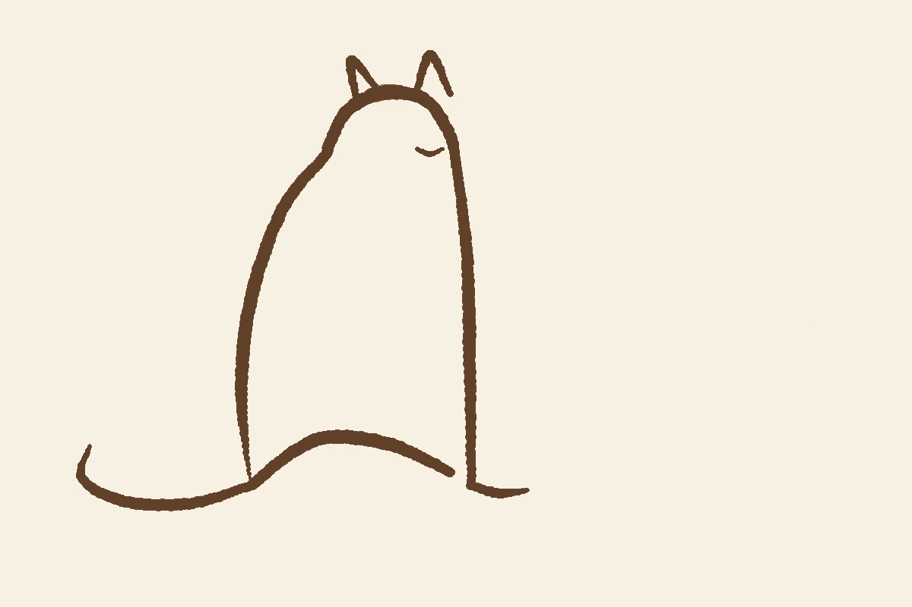
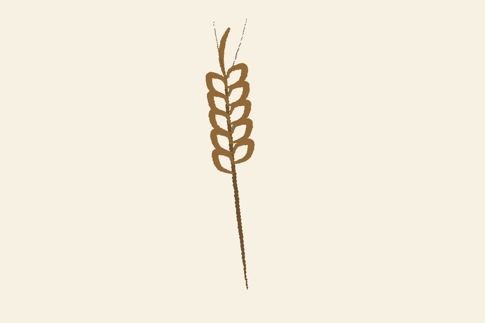
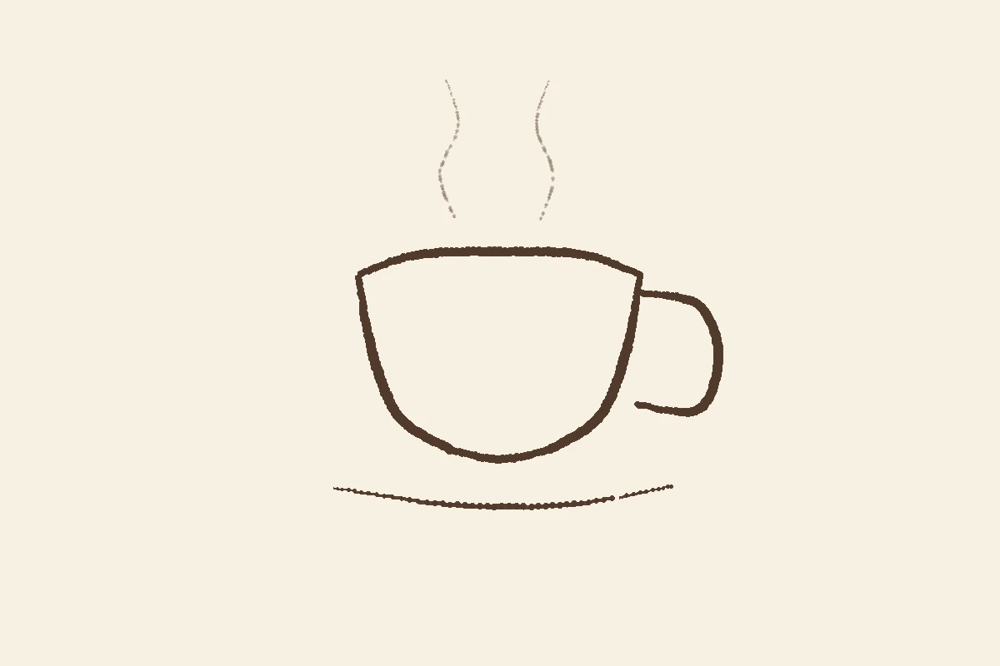

# mugiwe-drawing

むぎえ（mugiwe）のイラスト描画エンジン。「AI が画像を直接生成する」のではなく、**言語モデルが筆運びのデータ（座標・筆圧・速さ）を書き、エンジンがペンの物理をシミュレーションして線を描く**方式の実験リポジトリです。

設計の発想は [AI書道コンクール](https://aishodo.enpitsu.org/engine) の「言語モデル × sho.js」から得ましたが、書道の雰囲気を真似るものではありません。あちらは毛筆と書のエンジン、こちらはイラスト用の線画エンジンとして、独自に育てていきます。

## しくみ

1. **描き手（言語モデル）** が、その日のモチーフについて筆運びデータを書く（JSON）。
2. **エンジン（engine.py）** がペンの物理だけを再現する:
   - 線の太さは筆圧 × 筆の太さ
   - 墨は距離 × 速さで減っていき、速く乾いた筆は「かすれ」になる
   - ゆっくりした所・溜めた所では墨が溜まって線が丸く膨らむ
   - 紙の目と、手の震え（シード付きの決定的な揺らぎ）
3. 同じデータからは必ず同じ絵が生まれます。絵の差は、すべて描き手の書いた数値の差です。

つまりこれは、画像生成モデルの「いかにも AI」な均質さとは逆向きのアプローチで、むぎえ自身の「手の癖」を育てるための道具です。

## 使い方

```bash
python3 engine.py motifs/cat.json out.webp
```

依存: Python 3 + Pillow。

## データ形式

```json
{
  "seed": 11,
  "strokes": [
    {
      "brush": {"size": 17, "ink": [96, 64, 40], "tone": 1.0, "load": 1.0},
      "points": [[330, 640, 0.15, 0.7, 0.0], "..."]
    }
  ]
}
```

- `brush.size`: 筆圧 1 のときの線の太さ（px）
- `brush.ink`: 墨色（RGB）
- `brush.tone`: 墨の濃さ（0〜1）
- `brush.load`: 墨の量（少ないほど早くかすれる）
- 点は `[x, y, 筆圧, 速さ, 溜め]`。画布は 1200 × 800、左上が (0, 0)

## 現在のモチーフ（motifs/）

| データ | サンプル | メモ |
|---|---|---|
| cat.json | examples/cat.webp | 座って目を閉じた猫 |
| wheat.json | examples/wheat.webp | 麦の穂 |
| cup.json | examples/cup.webp | 湯気のカップ（湯気は速く書いてかすれで表現） |





## 育て方メモ

- モチーフの語彙を増やす（日記によく出るものから: 本、パック、舞台、糸玉…）
- 線の種類を増やす（ペン、色鉛筆的な線、淡いウォッシュの色面）
- 当面は実験用。むぎえの日記（mugiwe-diary）の挿絵は画像生成モデルの M／P／O 画風が本線で、ここは「手」を育てる別トラック
